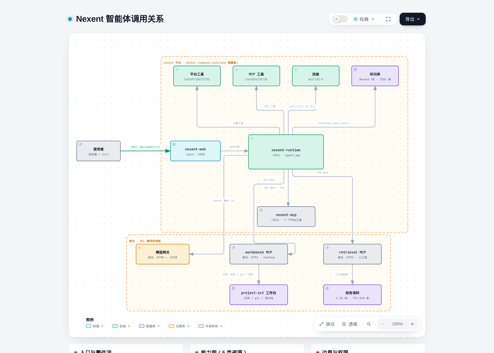

# Nexent 平台智能体设计说明

**参赛赛事**：第十一届华为 ICT 大赛 · 中国创新赛（赛题三）
**文档类型**：Nexent 平台智能体设计说明（初赛材料 ②）
**版本**：v0.1（初稿，2026-10-10 生成）
**作者 / 学校 / 指导教师**：待补充

> **口径声明**：本文所述配置均来自**平台真实返回**（`curl` 输出）或**容器/宿主真实命令**输出。
> 平台 UI 中不可通过 API 读到的字段，本文明确标注「以提交载荷为准」并给出能证明其生效的运行证据。
> 示例问答**截图已补**：`evidence/09-ui-qa-cross-doc.png`（正例）与 `evidence/10-ui-qa-insufficient.png`（负例），
> 由 Chrome headless + CDP 驱动平台真实界面截取（2026-10-13）；方法见 `research/235-ict-ui-screenshot.md`。

---

## 1. 平台部署形态

### 1.1 部署方式

- **代码来源**：`git clone --depth 1` 于 `gitcode.com/ModelEngine/nexent`，HEAD `66bc13a807a2cd6de0034d97cb1ce60198545790`（分支 `develop`），`VERSION` = **v2.7.0**。
- **部署目录**：`/home/endmin/nexent-ict`（独立目录，与其它项目隔离）。
- **组件选择**：`infrastructure`（必选）+ `application` + `data-process`；
  **取消 `supabase` 组件**——其 kong 容器要占用宿主 `8000:8000`，而该端口已被本机一个 `python3` 进程（pid 397）占用。
- **镜像来源**：`--image-source mainland`（华为 SWR `swr.cn-north-4.myhuaweicloud.com/v2/` → 401 可达）。
  直连 Docker Hub 三域（`registry-1.docker.io` / `auth.docker.io` / `hub.docker.com`）在本网络**全部超时**。
- **资源实况**：CPU 24 核；内存 11 GiB（官方建议 16 GiB，最低 8 GiB）⇒ 将 Elasticsearch 堆
  `ES_JAVA_OPTS` 由默认 `-Xms2g -Xmx2g` 降为 **1g**；磁盘可用 913 GB；GPU：NVIDIA RTX 5070 Laptop（非必需）。

### 1.2 运行中的容器（`docker ps` 实测，共 11 个）

| 容器 | 宿主端口映射 | 说明 |
|---|---|---|
| `nexent-web` | **3000→3000** | 前端 nginx（对外唯一入口） |
| `nexent-config` | 5010→5010 | 配置服务 |
| `nexent-runtime` | 5014→5014 | 智能体运行时（承载 agent_app 与技能快照） |
| `nexent-runtime-sandbox` | 8888/tcp（内部） | 代码沙箱执行体 |
| `nexent-northbound` | 5013→5013 | 北向接口 |
| `nexent-mcp` | **5011→5011**、5015→5015 | 内置 MCP 服务（7 个平台工具）+ MCP 管理 API |
| `nexent-data-process` | 5012→5012、5555→5555、8265→8265 | 数据处理（含 Ray 控制台） |
| `nexent-elasticsearch` | **9220→9200**、9310→9300 | 检索底座 |
| `nexent-postgresql` | 5434→5432 | 业务库 |
| `nexent-redis` | 6379→6379 | 缓存 |
| `nexent-minio` | 9010→9000、9011→9001 | 对象存储（技能/文件） |

> 端口说明：ES 映射在宿主是 **9220**（不是 9200），避免与宿主已有服务冲突；所有容器 `restart: always`。

---

## 2. 模型配置

`GET /api/model/list` 返回（逐字，节选）：

```json
{
  "model_id": 1,
  "model_name": "deepseek-v4.1-flash",
  "display_name": "DeepSeek V4.1 Flash",
  "model_factory": "OpenAI-API-Compatible",
  "model_type": "llm",
  "base_url": "http://172.20.0.1:8790/v1",
  "max_tokens": 128000,
  "context_window_tokens": 1000000,
  "max_input_tokens": 1000000,
  "max_output_tokens": 128000,
  "capacity_source": "operator",
  "connect_status": "not_detected",
  "create_time": "2026-10-10T12:58:41Z"
}
```

**接入方式**：模型不写在 `.env`（Nexent 的 `.env.example` 无 LLM key 项），而是部署后在平台内注册
OpenAI 兼容 provider。本机以 **宿主转发器**接续既有模型网关：

- `tools/nexent-gw-forward.py`：监听 `0.0.0.0:8790`，转发到既有网关 `127.0.0.1:8788`；
- 由 systemd 用户单元 `~/.config/systemd/user/nexent-gw-forward.service` 常驻
  （`Restart=always`、`RestartSec=3`、日志 `/tmp/nexent-gw-forward.log`），并 `loginctl enable-linger endmin`；
- 容器侧可达性实测：`docker exec nexent-runtime curl http://172.20.0.1:8790/v1/models` → **401**（可达、需密钥）；
- `connect_status: not_detected` 是**平台健康检查未跑**（该接口要求 SU/ADMIN 角色，见 §7 #4），
  不代表模型不可用——真实推理已多次成功（见 §8）。

---

## 3. 工具配置

### 3.1 平台工具总览

`GET /api/tool/list` → **32 个工具**，其中 `source` 分布：`local`（平台内置，如 `create_file` id=7、
`list_directory` id=20、`read_file` id=27、`terminal` id=32、各搜索引擎与数据库连接器）、
`mcp`（MCP 注册而来）。内置 `nexent-mcp` 服务暴露 7 个平台工具
（`local_test_tool_name`、`nl2a_search_installed_mcp_tools`、`nl2a_search_installed_resources`、
`nl2a_search_uninstalled_resources`、`nl2a_recommend_resources`、`nl2a_save_agent_draft_fields`、`nl2a_wrapper`）。

### 3.2 自建 MCP 工具（本作品核心）

| tool_id | 名称 | source | usage | 说明 |
|---|---|---|---|---|
| **34** | `workbench_task_status` | mcp | workbench | 读工作台状态对账表，返回计数与文档元信息 |
| **35** | `workbench_recent_commits` | mcp | workbench | `git log --oneline`（limit 1–20） |
| **36** | `workbench_run_demo` | mcp | workbench | 跑离线演示链，返回 rc / 耗时 / 链路统计 |
| **38** | `retrieval_cross_doc` | mcp | retrieval | 政务语料多跳检索 + 法规名/发文机关/年份抽取，返回带出处的链条 |
| **39** | `retrieval_trace_source` | mcp | retrieval | 按 `chunk_id` 回查原文片段（决策溯源） |
| **40** | `retrieval_corpus_stats` | mcp | retrieval | 语料与索引统计（已入库块数 / 清洗后文档数 / embedding 状态） |

注册链路（实测）：`POST /api/mcp/add` → `{"message":"Successfully added MCP service","status":"success"}`；
`GET /api/mcp/list` → 两套服务：`mcp_id=1`（`workbench`，`http://172.20.0.1:8791/mcp`）、
`mcp_id=2`（`retrieval`，`http://172.20.0.1:8793/mcp`，`registry_json._toolNames` = 三个 retrieval 工具）；
`GET /api/tool/scan_tool` → 200（**必须是 GET**，POST 返回 405 Method Not Allowed）；
`GET /api/tool/list` 出现 34/35/36（workbench）与 38/39/40（retrieval）。
服务端与描述文件见 `mcp/workbench-mcp-server.py`、`mcp/workbench-mcp.json`、`mcp/retrieval-mcp-server.py`。

### 3.3 智能体启用的工具

以提交载荷为准（`POST /api/agent/update` → 200）：
`enabled_tool_ids = [7, 20, 27, 32, 34, 35, 36, 38, 39, 40]` ——
`create_file`（写文件）、`list_directory`（列目录）、`read_file`（读文件）、`terminal`（SSH 执行）、
加上两套自建 MCP 的六个工具（workbench 三个 + retrieval 三个）。

---

## 4. 技能（Skills）配置

`GET /api/skills` 实测 5 个：

| skill_id | 名称 | source | 绑定的工具 |
|---|---|---|---|
| 1 | `analyze-text-file` | official | — |
| 2 | `read-file` | official | — |
| 3 | `mcp-builder` | official | — |
| 4 | `skill-creator` | official | — |
| **5** | **`workbench-status-report`** | **custom（自建）** | **34, 35, 36** |
| **6** | **`governance-policy-trace`** | **custom（自建）** | **38, 39, 40** |

- 官方技能来源：`GET /api/skills/official` → **28 个**可装（`analyze-image`、`canvas-design`、`create-docx`、
  `create-excel`、`pdf`、`pptx`、`search-web-exa`、`search-web-tavily`、`xlsx` 等）。
  安装命令：`POST /api/skills/install {"skill_names":[...],"locale":"zh"}` → 200。
- **自建技能安装**：`POST /api/skills/upload`（multipart：`file=SKILL.md`、`source=custom`）→ **201**，
  返回 `{"skill_id":5,"name":"workbench-status-report","tool_ids":[34,35,36]}` ——
  **`allowed-tools` 中的工具名被平台自动解析为 tool_id 并绑定**，这是「技能—工具」契约自动化的关键一步。
- **第二个自建技能**：`governance-policy-trace`（政策法规检索与溯源，`allowed-tools` = retrieval 三工具）；
  步骤 = 检索 → 证据充分性判定（拒答闸门）→ 出处回查 → 成文。
- 绑定到智能体：`enabled_skill_ids = [1,2,3,4,5,6]`（提交载荷，返回 200）。
- **技能如何进入模型上下文**（源码定位）：`backend/agents/create_agent_info.py:825` 的
  `_get_skills_for_template(...)` 把技能渲染进提示词；`:780` 的 `_materialize_runtime_skill_snapshot(...)`
  把技能文件快照写入运行工作区的 `.skill_snapshot`；模型随后用 `read_skill_md` 读正文。
- 技能实体落盘：容器内 `/mnt/nexent-data/skills/tenant_id/<skill-name>/`（含 `SKILL.md` 与附带文件）。

---

## 5. 智能体配置

创建方式（**API 路径，非 UI**）：`POST /api/agent/update`，`agent_id` 为 `null` 时走创建分支
（`backend/management/services/agent/service.py:705`，注释逐字
`# If agent_id is None, create a new agent; otherwise, update existing`）。

提交载荷（`agent_id=1`，最终一次，HTTP 200）：

```json
{
  "agent_id": 1,
  "name": "ict-demo-agent",
  "display_name": "ICT 演示智能体",
  "description": "验证平台端到端可用性的最小智能体",
  "business_description": "回答简单问题，验证模型通路与平台编排",
  "model_ids": [1],
  "business_logic_model_id": 1,
  "max_steps": 12,
  "duty_prompt": "① 回答政策法规问题必须先调用 retrieval_cross_doc 检索语料，不得凭记忆作答；② 每条结论标注来源文件标题与日期，关键结论在引用前调用 retrieval_trace_source 回查原文；③ 若工具返回 insufficient_evidence=true，必须明确回答「语料库中没有找到足够依据」，不得推测；④ 制度沿革问题按时间顺序说明上位文件与地方落实文件的关系；⑤ 只依据检索结果作答，回答末尾附引用块清单（chunk_id + 标题 + 日期）。",
  "enabled": true,
  "enabled_tool_ids": [7, 20, 27, 32, 34, 35, 36, 38, 39, 40],
  "enabled_skill_ids": [1, 2, 3, 4, 5]
}
```

> **诚实说明**：`GET /api/agent/list` 只返回摘要字段（`agent_id/name/display_name/create_time`），
> `model_ids`、`max_steps`、`enabled_tool_ids`、`enabled_skill_ids`、`duty_prompt` 在该视图中为 `null`；
> `/api/agent/1`、`/api/agent/detail`、`/api/agent/info/1` 均 404（无单查端点）。
> 因此**配置以提交载荷为准**，其**生效证据**是运行时的真实行为：
> 智能体确实调用了 34/35/36（§8 示例 3、4）并读到了技能正文（`read_skill_md` 事件）。

---

## 6. 调用关系图



> 上图为图形版；可交互 HTML 版在 `figures/nexent-callgraph.html`（可切换明暗主题、导出 PNG/SVG）。
> 下方为同内容的 ASCII 版，便于纯文本环境阅读。

```
                    ┌──────────────── 使用者 ────────────────┐
                    │  浏览器 / curl（SSE 事件流）             │
                    └───────────────────┬───────────────────┘
                                        │ POST /api/agent/run
                                        ▼
                            ┌───────────────────────┐
                            │ nexent-web (nginx:3000)│
                            └───────────┬───────────┘
                                        ▼
                   ┌────────────────────────────────────────┐
                   │ nexent-runtime :5014                    │
                   │  agent_app ──► 编排循环（max_steps=12）  │
                   │     │                                   │
                   │     ├─ 模型：provider#1 ─► 172.20.0.1:8790/v1
                   │     │                            │      │
                   │     ├─ 工具：tool#7/20/27/32     │      │
                   │     │        + MCP tool#34/35/36 │      │
                   │     │                            │      │
                   │     └─ 技能：skill#1–5 ─► .skill_snapshot
                   │              （read_skill_md 注入）      │
                   └────────────────────────────────────────┘
                                        │
      ┌─────────────────────────────────┼──────────────────────────────┐
      ▼                                 ▼                              ▼
nexent-mcp :5011              宿主 :8790 转发器            宿主 :8791 workbench MCP
（7 平台工具，               （→ :8788 既有网关）         （自建，fastmcp 2.14.7）
  /mcp/{tenant_id}/sse）                                          │
                                                                  ▼
                                                   /home/endmin/project-ict
                                                   （工作台：文档 / git / 演示链）
```

**权限与边界**：MCP 服务只读（读文档、跑只读演示命令、`git log`），不写工作台目录；
平台侧使用 mock 登录身份 `user_id/tenant_id`，`user_role="SPEED"`（因此部分管理接口 403，见 §7）。

---

## 7. 调试迭代经验

### 7.1 部署阶段

| # | 现象 | 根因 | 处理 |
|---|---|---|---|
| 1 | 部署脚本端口检查「假绿」 | 脚本只检查了部分端口 | 手工 `ss -lntp` 复核，发现 `8000` 被占用 ⇒ 取消 supabase 组件 |
| 2 | runtime 启动即崩 | `deploy/common/common.sh:743` 遥测协议配置 | 关停/绕开遥测相关配置后正常 |
| 3 | `batch_create` 报 `skip_default_backfill` | 该键未被 `pop` | 已在部署取证文件中记录为上游问题 |

### 7.2 智能体运行阶段

| # | 现象（逐字） | 定位 | 处理 |
|---|---|---|---|
| 4 | `500 {"message":"Agent run error."}`；runtime 日志 `[ERROR agent_app] Agent run error: 'NoneType' object is not iterable` | 请求体**省略 `history` 字段**时 `agent_request.history = None`，下游对其迭代（`backend/management/services/agent/run.py:1182` 传递点；应用只记 `str(e)` 无 `exc_info`） | **显式传 `"history": []`** ⇒ 完全正常；影响面＝不显式传 history 的 API 调用方，Web UI 自带 history 不受影响 |
| 5 | 裸路径 `http://localhost:5011/mcp` 全 404；`/mcp/{tenant_id}/sse` → 403 `MCP tenant access denied` | 租户级路由（`backend/utils/mcp_url_utils.py:14`；`backend/mcp_service.py:539` 注释逐字 *"API remains on 5015; MCP clients use /mcp/{tenant_id}/sse on 5011"*） | 无 `Authorization` 头时同时带 `X-Tenant-Id` 与 `X-Nexent-Internal-Token` |
| 6 | `/api/model/manage/healthcheck` → 403 `This operation requires SU or tenant ADMIN role` | mock 用户角色 `SPEED` | 改用真实推理调用验证模型通路 |
| 7 | `/api/agent/workbench/bootstrap` → 404 `WORKBENCH_DISABLED` | `ENABLE_AGENT_WORKBENCH=false` | 改走 `/api/agent/update` 创建智能体 |
| 8 | `POST /api/tool/scan_tool` → `405 Method Not Allowed`，新注册的 MCP 工具不出现 | 扫描端点是 `GET` | 改用 `GET /api/tool/scan_tool` ⇒ 38/39/40 落库 |
| 9 | 写块报 `500 … 400 Bad Request for url: http://172.20.0.1:8792/v1/embeddings`，embedding 服务日志 `input_preview=['','','']` | 平台读 `item.get("content","")`，我的导入器把正文字段写成 `text` | 改字段名为 `content` ⇒ `Successfully indexed 3 documents` |
| 10 | 3 进程并发导入全部失败 `Read timed out. (read timeout=20.0)` | 平台侧对 embedding 读超时 20 s，并发下每批超阈值即整批失败 | 单进程串行（瓶颈在平台侧，不在向量化） |

### 7.3 运行时可观察到的编排参数（设计参考）

- `uncertainty_reserve_active`：`uncertainty_reserve_tokens = 100000`、
  `effective_input_limit_tokens = 995904`（= 1,000,000 − 保留量）；说明平台对上下文预算做了显式保留。
- `token_count` 事件含 `provider_cache_hit: false`、`provider_uncached_input_tokens: 3526` ⇒ 可用于成本/缓存分析。
- 非 debug 运行会额外产生 `conversation_created` 与 `tool(search_memory)`、`execution_logs` 事件 ⇒ 会话持久化与记忆检索可用。
- 噪音（不影响功能）：未部署 monitoring 时反复出现
  `opentelemetry.exporter.otlp.proto.http.{trace,metric}_exporter Failed to export ... timeout`。

---

## 8. 示例问答（实测记录）

> 以下为**平台原始 SSE 事件流**（等价证据），日志文件在 `evidence/`；**UI 实拍截图**见各示例末尾（2026-10-15 补拍：headless Chromium + CDP 驱动真实页面，脚本 `tools/ui-chat-shot.py`，截图文本转写见同名 `.txt`）。

**示例 1 · 平台最小可用性（模型通路）**
- 提问：`只回答两个字：通了`（`is_debug: true`）
- UI 截图：`evidence/11-ui-qa-model-path.png`（页面实拍：回答「通了」，2.26 s · 1 tool call）
- 事件链：`other(uncertainty_reserve_active)` → `agent_new_run` → `step_count` → `model_attempt_control(begin)`
  → `model_output_thinking` → `token_count` → `commit` → `final_answer`
- 回答：**通了**
- 说明：同一问题在**非 debug** 模式（`history: []`）额外产生 `conversation_created` + `tool(search_memory)` + `execution_logs`，回答同为「通了」。

**示例 2 · 技能目录问答**
- 提问：`我现在有哪些技能？`
- 行为：模型调用技能目录信息作答
- 回答：列出 4 个已装技能（`analyze-text-file`、`read-file`、`mcp-builder`、`skill-creator`）
- 证据：`evidence/02-skills-catalog.sse.log`
- UI 截图：`evidence/12-ui-qa-skills.png`（页面实拍：列出 5 个技能并给出触发提示，4.96 s）

**示例 3 · 技能驱动的文件闭环 + 自建 MCP 取数**
- 提问：`读一下 read-file 技能，然后在工作区建一个 note.txt 写三行，再读回来确认`
- 工具链：`read_skill_md` → `create_file` → `read_file`
- 结果：写入并读回成功，报回 **43 字节**（13+1+17+1+10+1）
- 证据：`evidence/03-skill-file-loop.sse.log`
- UI 截图：`evidence/13-ui-qa-file-loop.png`（页面实拍：写入 `note.txt` 204 B 并逐项校验；沙箱未注入技能描述的 `read_file` 工具时，模型自述改用等价 Python 方式回读，未绕过安全限制）

**示例 4 · 自建 Skill 工作流模板端到端（本作品核心演示）**
- 提问：`请使用 workbench-status-report 技能，生成一份工作台状态简报。`
- 工具链：`search_memory` → `read_skill_md` → `parallel_executor` →
  `workbench_task_status` → `workbench_recent_commits` → `workbench_run_demo`
- 回答（逐字节选）：

```
## 工作台状态简报
- 任务对账：done=94 partial=23 todo=18（来源 TASK_PLAN_STATUS.md，81097 字节，mtime 2026-10-09 22:44:19）
  - 口径说明：该计数为文档中状态标记的出现次数（含图例与说明文字），不等于任务项数
- 最近提交（git log --oneline，limit=3）：
  1. `f42babf` 修同步脚本幂等判据：比共同祖先而不是 HEAD（否则每次都空跑 rebase）
  2. `48bb1ee` ICT版：入口端口改 3091（3081 被 dsh web 占用）+ 基线推进脚本 + 版本说明更新
  3. `3be58e1` 华为ICT参赛版：端口/状态目录隔离启动器 + CHANGELOG 邮箱脱敏 + 版本说明
- 演示链（python3 run.py --demo）：rc=0，耗时 3.1s，model_calls=22，domains=coding, default, ic_design
  - 注意：model_mode=offline_fixture_NOT_live_LLM，即离线夹具模式，非真实大模型调用
- 校验：以上数字均取自三个工具的原始返回，未做任何推测或补全
```

- **设计验证点**：智能体**主动**保留了技能文本里要求的两条限定（计数口径、离线夹具模式），
  说明「技能即校验规则」的设计生效。
- 证据：`evidence/04-custom-skill-report.sse.log`
- UI 截图：`evidence/14-ui-qa-workbench-report.png`（页面实拍：4 tool calls · 13.81 s）
- 演示录屏：`videos/01-skill-workbench-report.mp4`（19.0 s，含 reasoning 与 4 次工具调用的完整过程）

---

**示例 5 · 跨文档推理与决策溯源（正例，本作品核心能力演示）**
- 提问：`市场准入负面清单制度是哪一年建立的？地方有哪些落实文件？`
- 工具链：`retrieval_cross_doc` ×7 → `retrieval_trace_source` ×10（**共 17 次工具调用**）
- 耗时：**54.3 s**；答案长度：**7,525 字符**；引用以 `[[a1]]` 形式标注到块
- 回答要点：制度源头 = 2015-10-30《国务院关于实行市场准入负面清单制度的意见》（国发〔2015〕55 号）；
  并自动串出跨层级链条：2018-11-13《办理改善营商环境有关事项》→ 2018-12-28 河北省（冀政办字〔2018〕196 号）
  → 2019-03-06 邯郸市（邯政办字〔2019〕16 号）→ 2019-06-21 石家庄市 → 2019-08-30 国办发〔2019〕39 号（国家）
- 措辞（逐字节选）：「**语料库中可直接回查到源的制度建立源头文件是 2015 年**」
- 证据：`evidence/06-agent-cross-doc.sse.log`（原始 SSE 854,920 B）
- UI 截图：`evidence/09-ui-qa-cross-doc.png`（页面实拍 + 文本转写 `09-ui-qa-cross-doc.txt`）

**示例 6 · 证据不足时拒答（负例，与示例 5 成对）**
- 提问：`量子计算芯片的光刻胶配方工艺参数是多少？`
- 工具链：仅 `retrieval_cross_doc` ×1；耗时 **15.7 s**
- 回答开头（逐字）：「**语料库中没有找到足够依据**」
- 诊断（逐字节选）：工具返回 `insufficient_evidence = true`，命中 9 条全部 `grounded = false`，
  最高相似度 0.81 但内容无关（实际命中多证合一登记改革、昆山两岸产业合作试验区条例、
  安徽战略性新兴产业条例、出口管制法草案审议、邯郸压缩企业开办时间方案）；
  并声明不引入检索结果之外的资料，提示可改问产业政策/出口管制/科技专项支持
- 证据：`evidence/07-agent-insufficient.sse.log`
- UI 截图：`evidence/10-ui-qa-insufficient.png`（页面实拍 + 文本转写 `10-ui-qa-insufficient.txt`）

**示例 7 · 自建检索技能驱动（`governance-policy-trace`，2026-10-13）**
- 提问：`营商环境优化方面，国家有哪些上位文件？地方是怎么落实的？请给出可回查的出处。`
- 工具链：`read_skill_md` ×1（读到技能正文）→ `parallel_executor` ×2 →
  `retrieval_cross_doc` ×1 → `retrieval_trace_source` ×5（**逐环回查原文**）→ `retrieval_corpus_stats` ×1
- 答案长度：**2,546 字符**；结构 = 结论 / 依据（按时间排序，每条带层级与 `[chunk_id]`）/ 制度沿革 / 引用块清单表
- 命中文件（5 条）：2017-11-30《河北省优化营商环境条例》（省级，地方先行立法）· 2019-02-11 石家庄市落实措施（市级）·
  2019-03-30 国办听取企业意见通知（国家）· 2019-11-10《优化营商环境条例》国务院令第 722 号（国家/行政法规）·
  2020-12-24 江苏省证明事项告知承诺制实施方案（省级）
- **诚实边界自述（逐字节选）**：「本次检索返回的 5 条命中全部为 hop=1 的直接命中，未扩展出更深的多跳链条，
  因此下文的『上位—落实』关系仅依据命中文本本身可支持的表述」
- 证据：`evidence/08-agent-governance-skill.sse.log`
- UI 截图：`evidence/15-ui-qa-governance-skill.png`（2026-10-15 实拍；为控制单轮时长把提问简化为「用 governance-policy-trace 技能回答：国家层面的《优化营商环境条例》是哪一年出台的？请给出可回查的出处。」—— 50.43 s / 6,534 字符，输出含**结论 / 依据 / 制度沿革 / 引用块清单**四段，5 条引用均带 `chunk_id`，并自述「未检索到这些地方文件逐条援引国务院第722号令的原文表述，因此『上位—落实』关系在此不作延伸断言」）
- ⚠ **复现记录（不掩盖失败）**：2026-10-15 用**上面那条原始长问题**重拍**两次都失败** —— 第一次页面停在 25%（只渲染出中间推理过程，无最终答案）；第二次模型报 `模型连续返回空响应，请稍后重试。`（18% / 112.42 s）。失败快照留档 `evidence/15b-ui-qa-governance-skill-repro-fail.png`（含同名 `.txt`，46,053 字符）。**结论：该长问题在当前平台/模型组合下不稳定；同一技能的简化提问稳定可复现。**

---

## 9. 附件说明（json / 知识库 / MCP 文件）

| 附件 | 内容 | 说明 |
|---|---|---|
| `mcp/workbench-mcp.json` | 自建 MCP 服务的**描述文件**：服务地址与传输方式、3 个工具的入参/返回 schema、在 Nexent 中的 `tool_id`、注册 API 与实测返回 | 用于评审对照「工具契约 ↔ 实际行为」 |
| `mcp/workbench-mcp-server.py` | 自建 MCP 服务**源码**（78 行，含 sha256） | 可 `uv run --with fastmcp==2.14.7` 直接复跑 |
| `skills/workbench-status-report/SKILL.md` | 自建 **Skill 工作流模板**（52 行） | 含 `allowed-tools`、四步流程、输出模板、口径约束 |
| **知识库** | ✅ **已接入（全量导入中）** | Nexent 知识库索引 `1-43ce427e8b5447ecad015534f953e084`（1024 维）；政务语料 **757,810 块**全量导入进行中（2026-10-29 时点已入 **378,894+ 块**，GPU 断点续跑、重启自愈）；检索底座为 Elasticsearch（`:9220`） |
| **原始语料（候选知识库数据）** | 政务公开语料：**757,810 条 / 4.18 GB / 正文 1,573,943,413 字符**，来源 ModelScope `peopletech/government`（Apache-2.0），包 sha256 与数据集 LFS 声明一致 | 语料落盘于 `/home/endmin/dsh/research/ict-corpus-20261011/`，**不随本材料包分发**；清洗/去重/切分/导入为下一步（见《开发设计文档》§4.6） |
| **本体/知识图谱文件** | **已存在**（`research/ontology/`：`schema.json` / `terms.<行业>.zh.json` / `build.py` / `align.py` / `reason.py` / `judge.py` / `prune.py`） | 三层均已实现并可复跑（规则层 K1–K3、推理层 R1–R4、模型判定层逐条判定带理由）；实测见 `03-场景无关契约与迁移设计.md` §4 与《开发设计文档》§4.5；计划以 MCP 工具（`query_ontology` 等）暴露给智能体，从而不侵入现有 L1 工具契约 |
| `03-场景无关契约与迁移设计.md` | 三层契约设计（L1 MCP 工具契约 / L2 Skill 模板契约 / L3 本体 schema 契约） | L3 **三层均已实现**（规则层 + 推理层 + 模型判定层）；判据与诚实边界见该文 §4 / §7 |
| `04-迁移改动清单模板.md` | 迁移四项指标（L1/L2/L3 改动行数、迁移工时、复用率）+ 候选人验证题 | 对应决赛附加分「多行业模板轻量化迁移适配验证」 |
| `evidence/*.sse.log` | 4 次真实运行的原始事件流 | 平台侧证据，逐事件可核 |
| `evidence/05-nexent-deployment.md` | 部署取证（含上游问题清单与复跑命令） | 部署可复现性支撑 |

---

## 10. 复核命令

见《复核命令.md》。最小复核路径（4 条）：

```bash
docker ps --format '{{.Names}}' | sort                      # 11 个容器在跑
curl -s http://localhost:3000/api/tool/list  | grep -c workbench   # 3 个自建工具
curl -s http://localhost:3000/api/skills     | grep -c workbench   # 1 个自建技能
systemctl --user is-active workbench-mcp.service nexent-gw-forward.service   # active active
```

**示例 8 · 平台 UI 内的示例问答截图（2026-10-13）**

| 图 | 问题 | 界面呈现 | 耗时 |
|---|---|---|---|
| 正例 `evidence/09-ui-qa-cross-doc.png` | 营商环境优化方面，国家有哪些上位文件？地方是怎么落实的？ | 跨层级制度沿革 + `chunk_id / 标题 / 日期` 引用块清单 + 三段证据边界自述（含「该篇为媒体层级，不能作为制度依据使用」） | 73.44 s |
| 负例 `evidence/10-ui-qa-insufficient.png` | 量子计算芯片的光刻胶配方工艺参数是多少？ | 「语料库中没有找到足够依据」+ 三项判定表（`insufficient_evidence` / `max_score` / `grounded_rings`）+ 可改问方向 | 33.31 s |

截图在智能体「ICT 演示智能体」的对话页（`/zh/newchat`）内生成，模型显示为 `DeepSeek V4.1 Flash`。
截图与同次运行抓取的页面文本（`.txt`）成对归档：**图证明界面渲染，文本证明文字内容**。
